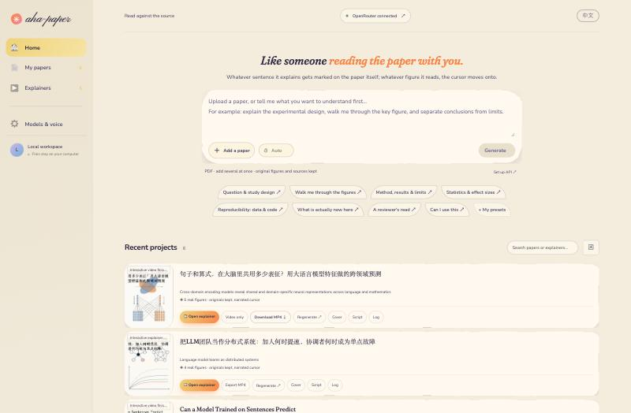
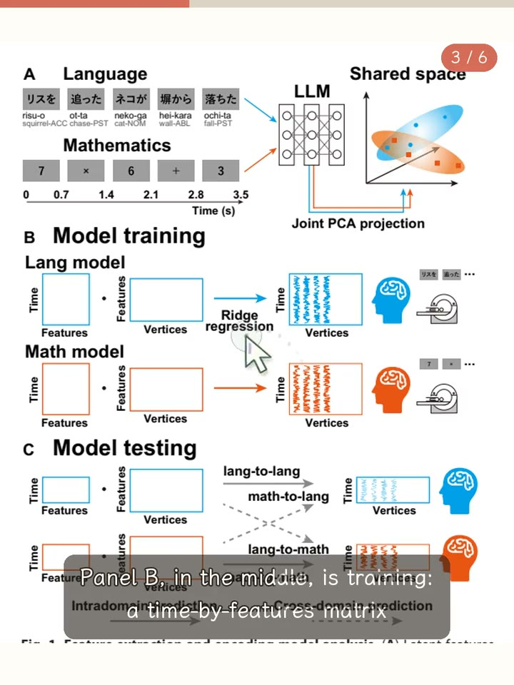
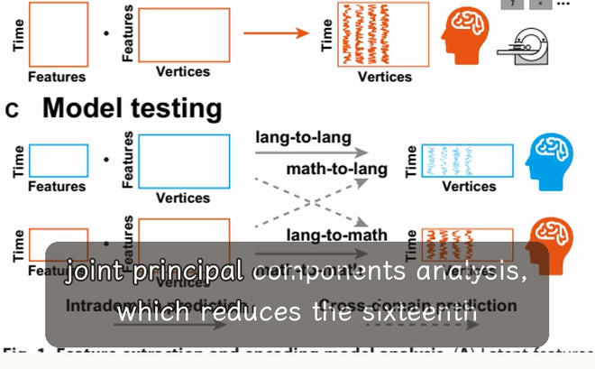
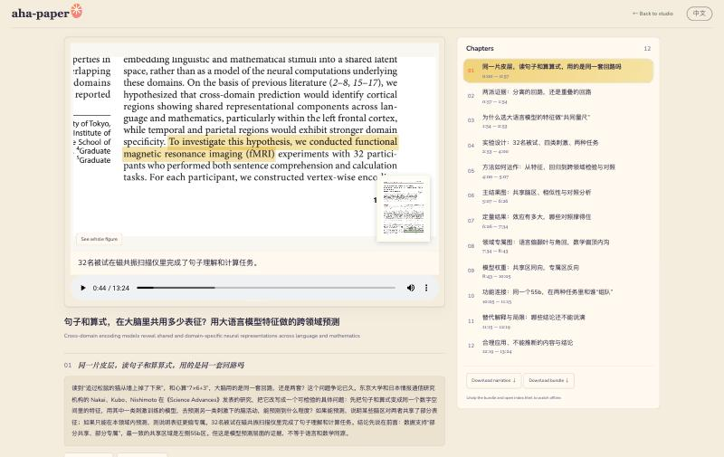
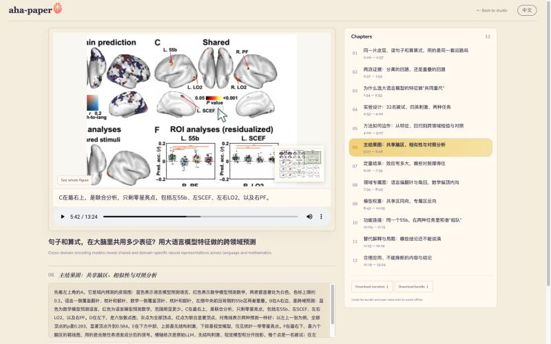

<div align="center">

# aha-paper

**Turn a paper into a guided read.**<br>
It narrates a PDF while marking the sentence it is explaining — on the paper itself.

[](https://github.com/yh2072/aha-paper/actions/workflows/ci.yml)
[](LICENSE)
[](requirements.txt)
[](app/lang.py)

[English](#english) · [中文](#中文)

<br>



</div>

---

## See it

One paper, read end to end: **“Cross-domain encoding models reveal shared and
domain-specific neural representations across language and mathematics”**
(*Science Advances*). Nothing below was staged for a screenshot — it is a real
explainer, played back.

<div align="center">

<a href="docs/media/demo.mp4"></a>

**[▶ Watch the 92-second demo](docs/media/demo.mp4)** &nbsp;·&nbsp; 720×960 · 2.7 MB

<sub>GitHub strips <code>&lt;video&gt;</code> from a README, so the file opens on its own page — where it plays.</sub>

<br>



<sub><i>The pointer is not being dragged. Each position is a region the model was
asked to name for one sentence of narration, so it arrives before the voice does.</i></sub>

</div>

<table>
<tr>
<td width="50%" valign="top">

**读一遍 · The read**

12 chapters · 13 minutes · 4 figures walked panel by panel, 8 chapters read off
the paper's own pages. Every chapter cites the PDF pages it rests on.

</td>
<td width="50%" valign="top">

**两种语言 · Either language**

The same paper, read again in English — a different writer's persona, a
different voice, a different rule for where a sentence ends. The video and the
animation are the English read; the two stills below are the Chinese one.

</td>
</tr>
</table>

### It marks the sentence it is saying



The voice says *“32 participants completed sentence-comprehension and calculation
tasks inside the scanner.”* The page shows **the sentence that claim came from**,
marked where it actually sits. The highlight is not drawn from the model's idea of
where the text is — it is computed from the PDF's own text layer, so a quotation the
model invented resolves to nothing and nothing gets drawn.

### It points at the panel it is describing



Same rule, applied to a figure. The narration names panel C and the regions in it;
the cursor is already there, and the view has zoomed to the part being discussed.
The figure is the paper's own — nothing on screen is an illustration of the paper,
because an illustration is a place a mistake can hide.

---

## English

Every frame on screen is either **a figure from the paper** or **a page of the paper**. The model answers one question — *which sentence of the source is this line of narration explaining?* — and every coordinate is computed from the PDF's own text layer.

That split is the point. A wrong answer can highlight a different real sentence; it cannot invent a position. A fabricated quotation simply fails to resolve, so nothing is drawn.

### Quick start

```sh
python -m venv .venv
.venv/bin/pip install -r requirements.txt
npm ci --ignore-scripts
cp .env.example .env          # add OPENROUTER_API_KEY
.venv/bin/uvicorn app.main:app --host 127.0.0.1 --port 8321
```

Open <http://localhost:8321> and drop in a PDF. Keys are written only to a local `.env`; the API reports whether a provider is configured and never returns the credential itself.

**Requirements** — Python 3.11+, Node 22+, FFmpeg. Edge TTS needs no key but does need network.

#### With Docker

```sh
cp .env.example .env          # must exist: it is bind-mounted, not baked in
docker compose up --build
```

Three paths live on the host, not in the image: `data/` (papers and everything
generated from them), `.runtime/` (the provider credential store) and `.env`.
Saving a model or a voice in the interface writes back to `.env`, which is why it
is mounted rather than passed as environment variables.

#### As a desktop window

```bash
npm install && npm run desktop
```

Starts the server on a free port and opens it in a window — no terminal, no
URL to remember. It uses Electron's own Node for the provider CLI, so Node is
not a separate prerequisite.

This is the shell only: it runs against the Python environment on your machine.
Shipping it as a double-clickable app means bundling Python, the dependencies
and ffmpeg (~430 MB per platform) and signing the result. `app/bin.py` is the
part that makes that possible — every external program is resolved through it,
so a build can point `AHA_BIN_DIR` at the copies inside its own bundle.

#### Building an installer

```bash
npm run icon
npm run bundle:runtime
npm run dist:mac
```

`bundle:runtime` fetches a relocatable CPython, installs `requirements.txt` into
it, and fetches static ffmpeg and ffprobe into `runtime/`. The machine's own
copies cannot be used: a venv's interpreter is a symlink to a Python elsewhere
on disk, and Homebrew's ffmpeg links against dylibs under `/opt/homebrew`, so
either one produces a build that runs only where it was built.

The result is roughly 470 MB per platform — Electron ~150 MB, the wheels
~162 MB, ffmpeg and ffprobe ~92 MB, fonts and the figure model ~38 MB.

**Signing is yours to do.** Unsigned, macOS tells whoever downloads it that the
app "cannot be opened because the developer cannot be verified", and the only
way past that is right-click → Open. To avoid it you need an Apple Developer
account and a Developer ID Application certificate; then

```bash
CSC_LINK=... CSC_KEY_PASSWORD=... APPLE_ID=... APPLE_APP_SPECIFIC_PASSWORD=... APPLE_TEAM_ID=... npm run dist:mac
```

The hardened runtime is already configured, with the entitlements the bundled
CPython and the wheels' native extensions need (`build/entitlements.mac.plist`).

**ffmpeg's licence travels with it.** The static builds are redistributed
inside the app, so their licence ships beside them in `Resources/bin`. Check
which terms the build you fetch is under before handing the app to anyone.

#### Hosting it

A run takes about 18 minutes, writes roughly 86 MB per paper, and keeps working
on background threads after the HTTP response. That rules out serverless. It
suits anything that runs the container and keeps it up — Railway, Fly.io, Render,
or a small VPS with `docker compose`. The image reads `$PORT` where the platform
sets one.

Three constraints to carry over:

- **Mount a volume at `/app/data`.** Without one, every paper and everything
  generated from it disappears on each deploy.
- **One replica.** In-flight jobs live in a thread pool and a dict inside the
  process; a second instance would not see them.
- **Set `AHA_ACCESS_PASSWORD`.** Unset, there is no gate: anyone with the URL
  can upload papers, open the settings and spend your API credit.

Set, it puts one shared password in front of everything — studio, player, API
and the `data/` directory — and remembers it in a signed, `HttpOnly` cookie for
30 days. It is a door, not a user system: one password, no accounts, no roles.
Changing it signs everyone out. Guesses are rate-limited per client and in total.

Point the platform's health check at **`/api/ping`**, which stays open and
answers `{"ok": true}`. `/api/health` is behind the password, and a probe that
gets a 401 will have the platform restart a container that is serving fine.

### What it does

```
extract text → detect figures → write the script → storyboard
             → chapter visuals → blurb & title → collect figures → cover
```

Each stage has a completion test, so an interrupted run resumes without paying for finished work twice. A 12-page paper takes roughly **18 minutes cold**, about **12 of which is writing the script** (draft, an independent fact-and-page audit, then a length-and-structure revision). A fully cached rebuild takes about 2 seconds.

### The two kinds of frame

| | |
|---|---|
| **Figure** | A real figure from the paper. A cursor moves between its subfigures as the narration reaches them. |
| **Page** | The cited PDF page. The sentence being explained is struck through with a marker; its key terms are deepened and underlined. |

Highlights come from the character range `textpage.search()` returns, merged per line into one continuous band. A key term must clear two mechanical checks: it has to be a substring of the chosen sentence, and it has to resolve **inside that sentence's character range**. Anything else is dropped.

A chapter that matches nothing still shows the page it cites. There is no third renderer and no generated diagram.

### Length and scope

- **Length** — type any value from 3 to 30 minutes, or leave it blank for 11. The figure becomes a character budget and a chapter count at 300 characters per minute, holding chapters near 330 characters each.
- **Scope** — if the PDF carries bookmarks, its sections are listed after upload. Picking some is not a hint: **the writer is shown only those pages**, and a chapter citing anything outside them is rejected. A 152-page review can be explained one section at a time.

### Output

```
data/<id>/
├── explainer.json   chapters, per-clause timings, highlight geometry, source pages
├── narration.mp3    Edge TTS narration
├── pages/           rendered PDF pages
├── figures/         detected figures
└── aha-paper-interactive.zip
```

Unzip the bundle and open `index.html`: it plays offline, with no server and no key.

The interface is bilingual, translated at the DOM layer and keyed on the Chinese source string, so paper content and model output are never mistranslated.

### Configuration

Connect a provider once; every use shares its endpoint and credential, and each use picks its own model.

```dotenv
AHA_ACCESS_PASSWORD=                        # blank: no gate, for local use
LANGUAGE_PROVIDER=openrouter
OPENAI_MODEL=google/gemini-3.7-flash        # script and narration; needs image input
OPENROUTER_MODEL_COVER=openai/gpt-image-2   # cover
EDGE_TTS_VOICE=zh-CN-XiaoxiaoNeural
```

See `.env.example` for every key. Models and voice are locked while a run is in flight; changing the voice or rate re-synthesises the narration.

### Development

```sh
.venv/bin/python -m unittest discover -s tests -q
```

152 tests, no network required. Several are negative controls: a fabricated quotation finds no position in a real text layer, a section id the outline does not hold is refused, and no credential appears in any API response.

A few need a sample paper under `data/` and skip without one.

### Acknowledgements

- [Twemoji](https://github.com/jdecked/twemoji) — interface icons, graphics CC-BY 4.0, see `web/emoji/LICENSE.txt`
- [Pi](https://github.com/earendil-works/pi) — provider and model catalogue, MIT, installed with the npm dependencies
- [Edge TTS](https://github.com/rany2/edge-tts) — speech synthesis

---

## 中文

屏幕上的每一帧，**要么是论文自己的插图，要么是论文自己的页面**。模型只回答一个问题——「这句旁白在讲原文的哪一句」——所有坐标都由 PDF 的文字层算出。

这个分工就是关键。答错了，最多是标到另一句真实存在的话；它造不出一个位置。编造的引文根本定位不到，于是什么也不会画。

### 快速开始

```sh
python -m venv .venv
.venv/bin/pip install -r requirements.txt
npm ci --ignore-scripts
cp .env.example .env          # 填入 OPENROUTER_API_KEY
.venv/bin/uvicorn app.main:app --host 127.0.0.1 --port 8321
```

打开 <http://localhost:8321> ，拖进一个 PDF。Key 只写入本机 `.env`，接口只回「是否已配置」，绝不回传凭据本身。

**运行依赖** —— Python 3.11+、Node 22+、FFmpeg。Edge TTS 不需要 Key，但需要联网。

#### 用 Docker

```sh
cp .env.example .env          # 必须先建：它是挂进去的，不打进镜像
docker compose up --build
```

三个路径留在宿主机而不进镜像：`data/`（论文与全部产出）、`.runtime/`（供应商凭据）
和 `.env`。在界面里改模型或音色会写回 `.env`，所以用挂载而不是环境变量传入。

#### 当成桌面应用跑

```bash
npm install && npm run desktop
```

自动挑一个空闲端口起服务，并开一个窗口指过去——不用开终端，也不用记网址。
供应商 CLI 用的是 Electron 自带的 Node，所以不需要另外装 Node。

目前只有外壳：它跑的是你机器上的 Python 环境。要做成双击就能用的安装包，
得把 Python、依赖和 ffmpeg 一起打进去（每个平台约 430 MB）并签名。
`app/bin.py` 就是为此准备的——所有外部程序都从那里解析，
打包后把 `AHA_BIN_DIR` 指向自带的那份即可。

#### 打包成安装包

```bash
npm run icon
npm run bundle:runtime
npm run dist:mac
```

`bundle:runtime` 会下载一份可重定位的 CPython，把 `requirements.txt` 装进去，
再下载静态的 ffmpeg 和 ffprobe 到 `runtime/`。不能直接用本机那份：venv 里的
解释器是指向磁盘别处的符号链接，而 Homebrew 的 ffmpeg 链接到 `/opt/homebrew`
下面的 dylib——两者都会打出一个只在打包这台机器上能跑的包。

成品每个平台约 470 MB：Electron ~150 MB，wheels ~162 MB，
ffmpeg 与 ffprobe ~92 MB，字体和主图检测模型 ~38 MB。

**签名要你自己来。**不签名的话，别人下载后 macOS 会说"无法打开，因为无法验证
开发者"，只能右键→打开绕过。要免掉这一步需要 Apple 开发者账号和一张
Developer ID Application 证书，然后：

```bash
CSC_LINK=... CSC_KEY_PASSWORD=... APPLE_ID=... APPLE_APP_SPECIFIC_PASSWORD=... APPLE_TEAM_ID=... npm run dist:mac
```

加固运行时（hardened runtime）已经配好，包含自带 CPython 和各 wheel 里原生扩展
所需的 entitlements，见 `build/entitlements.mac.plist`。

**ffmpeg 的许可证要跟着走。**静态构建是随应用一起分发的，所以它的许可证文件
会放在 `Resources/bin` 旁边。把应用交给别人之前，先确认你下载的那份是什么条款。

#### 部署到哪里

一次任务约 18 分钟，每篇论文写出约 86 MB，而且 HTTP 响应返回后还在后台线程里继续跑。
这几条把 serverless 排除了。能跑容器并让它常驻的都合适——Railway、Fly.io、Render，
或者一台小 VPS 上 `docker compose`。平台注入 `$PORT` 时镜像会读它。

有三条约束要一起带过去：

- **给 `/app/data` 挂卷。**不挂的话，每次部署论文和全部产出都会消失。
- **只能单副本。**在跑的任务存在进程内的线程池和字典里，第二个实例看不到它们。
- **设 `AHA_ACCESS_PASSWORD`。**不设就是完全没有门：任何拿到网址的人都能上传论文、
  打开设置页、花掉你的 API 余额。

设了之后，工作室、播放页、API 和 `data/` 目录全部在一个共享口令后面，用签名的
`HttpOnly` cookie 记住 30 天。它只是一道门，不是账号系统：一个口令，没有账号也没有角色。
改口令等于把所有人登出。猜口令按客户端和全局两重限速。

平台的健康检查请指向 **`/api/ping`**——它不设门，只回 `{"ok": true}`。
`/api/health` 在口令后面，探针拿到 401 会让平台把一个服务正常的容器反复重启。

### 它做什么

```
抽取PDF文本 → 检测论文主图 → 生成口播稿 → 生成分镜
            → 章节画面 → 摘要与标题 → 整理章节配图 → 制作封面
```

每一步都有完成判定，中断后续跑不会为已完成的工作重复付费。一篇 12 页的论文冷启动约 **18 分钟**，其中约 **12 分钟花在写口播稿**（初稿、独立核对方法与页码、按字数与结构修订）。全缓存重跑约 2 秒。

### 两种画面

| | |
|---|---|
| **主图** | 论文自己的插图。光标随旁白在子图之间移动。 |
| **原文页** | 该章引用的 PDF 页。讲到的那句打上马克笔，关键词再加重并加下划线。 |

高亮来自 `textpage.search()` 返回的字符区间，按行合并成一条连续色带。关键词要过两道机械校验：必须是所选那句话的子串，且必须能在**那句话的字符范围内**定位到。过不了就丢弃。

一句都没对上的章节，仍然显示它引用的那一页。没有第三种渲染器，也没有生成出来的示意图。

### 时长与范围

- **时长** —— 填 3 到 30 之间的任意分钟数，留空按 11 分钟。按每分钟 300 字换算成字数区间和章节数，每章稳定在 330 字左右。
- **范围** —— 论文带书签时，上传后会列出它的小节。勾选不是提示而已：**写作模型只会看到那些页**，引用范围之外的页会被直接拒绝。一篇 152 页的综述可以一节一节地讲。

### 产物

```
data/<id>/
├── explainer.json   章节、逐句时间轴、高亮坐标、来源页码
├── narration.mp3    Edge TTS 旁白
├── pages/           渲染出的论文页
├── figures/         检出的主图
└── aha-paper-interactive.zip
```

互动包解压后打开 `index.html`：离线可播，不需要服务，也不需要 Key。

界面中英双语，在 DOM 层按中文原串翻译，所以论文内容和模型输出不会被误翻。

### 配置

供应商连接一次，所有用途共用它的端点与凭据；每种用途再各自挑一个模型。

```dotenv
AHA_ACCESS_PASSWORD=                        # 留空＝不设门，本机跑用这个
LANGUAGE_PROVIDER=openrouter
OPENAI_MODEL=google/gemini-3.7-flash        # 文稿与讲解，需支持图像输入
OPENROUTER_MODEL_COVER=openai/gpt-image-2   # 封面
EDGE_TTS_VOICE=zh-CN-XiaoxiaoNeural
```

完整键名见 `.env.example`。生成进行中不能改模型和音色；换音色或语速会重新合成旁白。

### 开发

```sh
.venv/bin/python -m unittest discover -s tests -q
```

152 个测试，不需要联网。其中若干条是负对照：编造的引文在真实文字层上找不到位置、目录里没有的小节编号会被拒绝、任何接口响应里都不会出现凭据。

有几条需要 `data/` 下的样本论文，缺了会自动跳过。

### 致谢

- [Twemoji](https://github.com/jdecked/twemoji) —— 界面图标，图形 CC-BY 4.0，见 `web/emoji/LICENSE.txt`
- [Pi](https://github.com/earendil-works/pi) —— 供应商与模型目录，MIT，随 npm 依赖安装
- [Edge TTS](https://github.com/rany2/edge-tts) —— 语音合成
