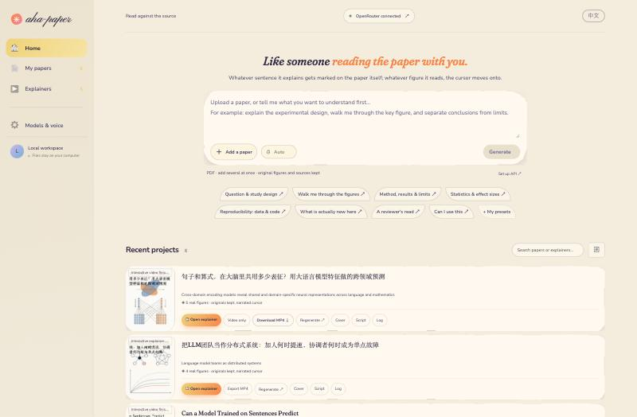
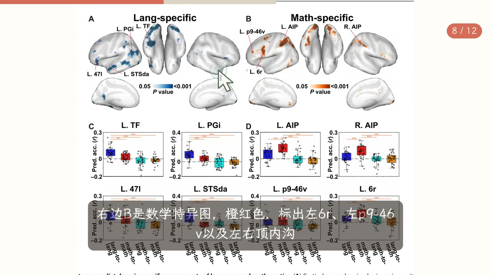
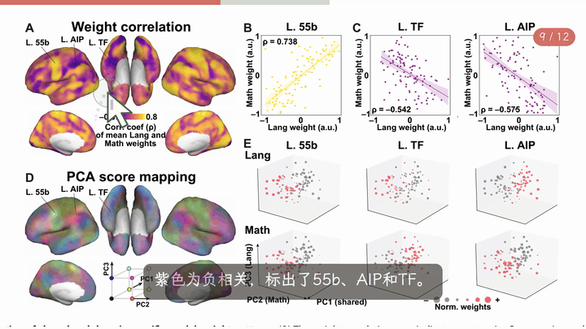
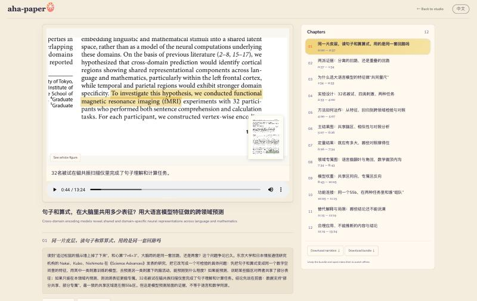
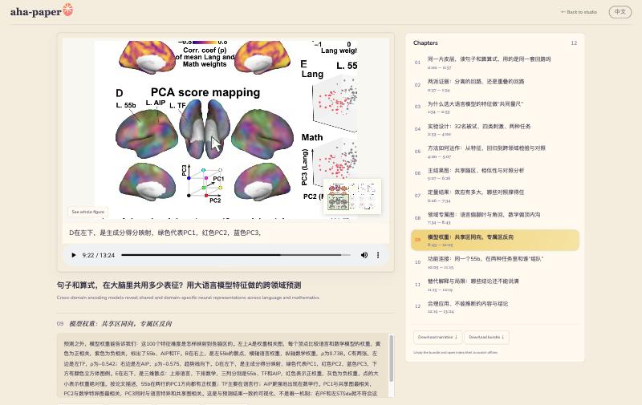

<div align="center">

# aha-paper

**把一篇论文，变成有人带着你读一遍。**<br>
它一边讲，一边在论文原文上标出正在讲的那一句。

[](https://github.com/yh2072/aha-paper/actions/workflows/ci.yml)
[](LICENSE)
[](app/lang.py)

**[▶ 在线试用](https://aha-paper.vercel.app)** &nbsp;·&nbsp; [English](README.md)

<sub>一份真实生成的讲解，直接在浏览器里播：12 章、13 分钟，不用注册也不用 Key。</sub>

<br>



</div>

---

## 看一眼

**[演示在 aha-paper.vercel.app](https://aha-paper.vercel.app)** —— 就是这份讲解导出的
互动包，作为纯静态站托管，没有任何后端。一篇论文，从头读到尾。视频是其中连续三章，未经剪辑——三张不同的图，一张一张逐面板讲过来。

<div align="center">

<a href="docs/media/walkthrough-16x9.mp4"></a>

**[▶ 看讲图演示](docs/media/walkthrough-16x9.mp4)** &nbsp;·&nbsp; 3 分 42 秒 · 1280×720

<sub>GitHub 会把 README 里的 <code>&lt;video&gt;</code> 删掉，所以视频单独打开——在它自己的页面上可以直接播放。</sub>

<br>



</div>

**讲到哪句，标哪句。** 旁白讲到有多少名被试进了扫描仪，页面上就标出这句话的出处，标在它真正所在的位置。



**讲到哪块，指哪块。** 旁白报出子图编号和里面的脑区，光标已经停在那里，画面也放大到了正在讲的部分。



> **演示里那篇论文。** Tomoya Nakai、Rieko Kubo、Shinji Nishimoto，
> 《Cross-domain encoding models reveal shared and domain-specific neural
> representations across language and mathematics》，*Science Advances* **12**，
> eaej5555（2026）。[doi:10.1126/sciadv.aej5555](https://doi.org/10.1126/sciadv.aej5555) ·
> 版权归原作者，依 [CC BY-NC 4.0](https://creativecommons.org/licenses/by-nc/4.0/) 授权。
> 上面的插图与页面是 aha-paper 原样呈现的，未作修改，用于非商业的工具演示。

---

## 为什么可以信

屏幕上的每一帧，**要么是论文自己的插图，要么是论文自己的页面**。模型只回答一个问题——「这句旁白在讲原文的哪一句」——所有坐标都由 PDF 的文字层算出。

这个分工就是关键。答错了，最多是标到另一句真实存在的话；它造不出一个位置。编造的引文根本定位不到，于是什么也不会画。没有第三种渲染器，也没有生成出来的示意图。

---

## 快速开始

```sh
python -m venv .venv
.venv/bin/pip install -r requirements.txt
npm ci --ignore-scripts
cp .env.example .env          # 填入 OPENROUTER_API_KEY
.venv/bin/uvicorn app.main:app --host 127.0.0.1 --port 8321
```

打开 <http://localhost:8321>，拖进一个 PDF。

需要 **Python 3.12+**、**Node 22+**、**FFmpeg**。Edge TTS 不需要 Key，但需要联网。Key 只写入本机 `.env`，接口只回「是否已配置」，绝不回传凭据本身。

一篇 12 页的论文大约 **5 分钟**，其中大半花在写讲稿。中断后续跑不会为已完成的工作重复付费，全缓存重跑约 2 秒。

---

## 更多

| | |
|---|---|
| [docs/setup.md](docs/setup.md) | Docker · 桌面窗口 · 打包并签名安装包 · 部署 |
| [docs/reference.md](docs/reference.md) | 两种画面 · 时长与范围 · 产物 · 配置项 |
| [CONTRIBUTING.md](CONTRIBUTING.md) | 三条要紧的规矩，以及怎么跑测试 |
| [CHANGELOG.md](CHANGELOG.md) | 改动记录 |
| [SECURITY.md](SECURITY.md) | 这个应用握着什么，以及怎么报告漏洞 |

## 致谢

[Twemoji](https://github.com/jdecked/twemoji) 的界面图标 ·
[Pi](https://github.com/earendil-works/pi) 的供应商与模型目录 ·
[Edge TTS](https://github.com/rany2/edge-tts) 的语音合成 ·
Fraunces、Nunito、Pinyon Script 三款字体。
完整署名与许可证见 [NOTICE](NOTICE)。

Apache-2.0。
